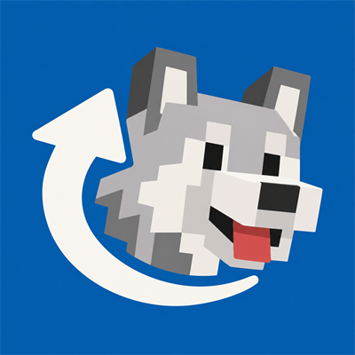

# Companion Call

Call your companions and mounts to your side, choose between them in a card interface, and keep their status close at hand.

[中文说明](README_zh.md)

## For players

- **Call a companion:** tap **V** to call the selected companion. The key can be changed in Minecraft's controls.
- **Choose a companion:** hold **V** to open the card selector, scroll to choose, and release the key to confirm. Press **Esc** to cancel.
- **Keep track:** the HUD displays the selected companion and recall status. Cards show the companion's appearance and available details.
- **Manage the list:** open management from the selector to hide or restore entries. Press **N**, or use the management interface, to add the entity you are riding. Adding an entity with an owner requires administrator permission.
- **Find your way back together:** a loaded companion navigates toward your changing position. When necessary, the recall system can locate and transfer the original entity across dimensions or from unloaded areas.

Tamed companions are registered as they are discovered. Other entities, including boats and minecarts, can be explicitly bound through the riding entry. The list and recall requests are checked by the server. A hidden entry does not kill the entity, and the mod does not resurrect dead companions.

### Installation

Install the standalone file matching your Minecraft version and loader on both client and server. Fabric also requires the matching Fabric API. The standalone file contains KltytonUI and its required script runtime dependencies. Do not install the standalone and `embedded` variants together; `embedded` is intended for a host such as Eden Realm that supplies KltytonUI itself.

| Minecraft | Loader | Java |
| --- | --- | --- |
| 1.20.1 | Forge, Fabric | 17 |
| 1.21.1 | NeoForge, Fabric | 21 |
| 26.1.2 | NeoForge, Fabric | 25 |
| 26.2 | NeoForge, Fabric | 25 |

Client settings control the HUD, selector, previews, management entry, add key, and HUD margins. Common settings control the hold threshold and recall recovery timing. Defaults are in Minecraft's controls and the `companion_call` configuration files.

### Commands

| Command | Purpose |
| --- | --- |
| `/companioncall list [page]` | List your registered companions. |
| `/companioncall select <uuid>` | Select one of your companions. |
| `/companioncall recall [uuid]` | Call the selected or specified companion. |
| `/companioncall force-recall <player> <uuid>` | Administrator: locate and transfer a player's companion. |
| `/companioncall set-owner <entity> <player>` | Administrator: set or transfer ownership. |

## Building from source

Each target has its own Gradle Wrapper. Put the matching KltytonUI JAR in `libs/kltytonui/<loader>-<KUI target>` and run `./gradlew build` (or `gradlew.bat build` on Windows) from the target directory. Minecraft 26.1.2 uses the KUI `26.1` target name. The Gradle process for 1.20.1 uses Java 21 with a Java 17 compilation toolchain. Build output is placed in the target's `build/libs` directory.

## Credits and license

Companion Call is licensed under [MIT](LICENSE). KltytonUI is licensed under LGPL-2.1; third-party notices are included with the distribution. The whistle sound is derived from [Eugene's Horse Whistle](https://github.com/kltyton/eugenes_horse_whistle/blob/b9910328c59a0924ce4f44c4a03b1fe12d46b453/src/main/resources/assets/eugenes_horse_whistle/sounds/whistle.ogg).
